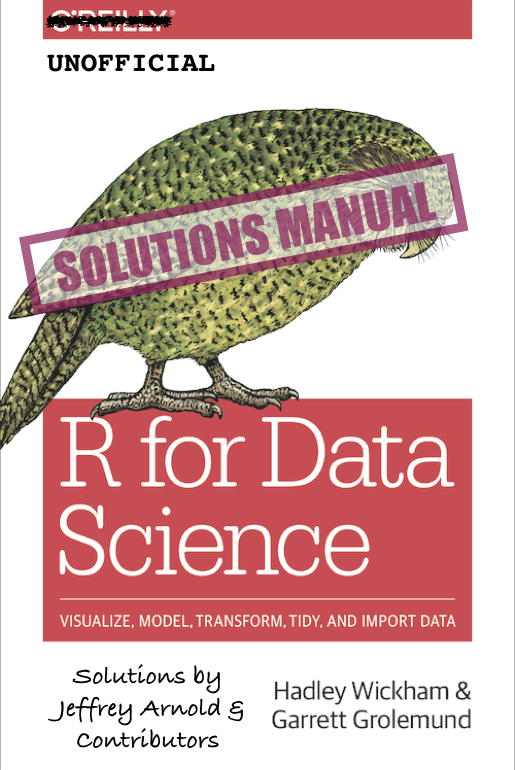

# Welcome {-}


```{=html}
<div class="alert alert-warning">
<p>
<strong>This book is superseded.</strong>
</p>
<p>
These are solutions to the 
<strong>1st edition</strong>
 of 
<em>R for Data Science</em>
. A 
<a href="https://r4ds.hadley.nz/">2nd edition</a>
 has since been published, with its own 
<a href="https://mine-cetinkaya-rundel.github.io/r4ds-solutions/">solutions to the exercises</a>
.
</p>
<p>This site is no longer maintained. It is kept online for reference.</p>
</div>
```




This book contains the **exercise solutions** for the **1st edition** of [*R for Data Science*](https://amzn.to/2aHLAQ1), by Hadley Wickham and Garret Grolemund [@WickhamGrolemund2017].

That edition is available online at [r4ds.had.co.nz](https://r4ds.had.co.nz/), and a physical copy is published by O'Reilly Media and available from [amazon](https://amzn.to/2aHLAQ1).

A [2nd edition](https://r4ds.hadley.nz/) of *R for Data Science* has since been published. These solutions have **not** been updated for it. For the current edition, see [R for Data Science (2e) --- Solutions to Exercises](https://mine-cetinkaya-rundel.github.io/r4ds-solutions/) by Mine Çetinkaya-Rundel.

## Acknowledgments {-}


These solutions have benefited from many contributors.
A special thanks to:

-   Garrett Grolemund and Hadley Wickham for writing the truly fantastic *R for Data Science*, without whom these solutions would not exist---literally.
-   [\@dongzhuoer](https://github.com/dongzhuoer) and [\@cfgauss](https://hypothes.is/users/cfgauss) for careful readings of the book and noticing numerous issues and proposing fixes.

Thank you to all of those who contributed issues or pull-requests on
[GitHub](https://github.com/jrnold/r4ds-exercise-solutions/graphs/contributors)
(in alphabetical order): [\@adamblake](https://github.com/adamblake), [\@aituarov](https://github.com/aituarov), [\@andrewyimingchen](https://github.com/andrewyimingchen), [\@AnttiRask](https://github.com/AnttiRask), [\@arbtyler](https://github.com/arbtyler), [\@beacurious](https://github.com/beacurious), [\@benherbertson](https://github.com/benherbertson), [\@bhishanpdl](https://github.com/bhishanpdl), [\@bob100000000000](https://github.com/bob100000000000), [\@carajoos](https://github.com/carajoos), [\@chrisyeh96](https://github.com/chrisyeh96), [\@clemonsa](https://github.com/clemonsa), [\@daczarne](https://github.com/daczarne), [\@dcgreaves](https://github.com/dcgreaves), [\@decoursin](https://github.com/decoursin), [\@delabi](https://github.com/delabi), [\@demar01](https://github.com/demar01), [\@dongzhuoer](https://github.com/dongzhuoer), [\@dvanic](https://github.com/dvanic), [\@edavishydro](https://github.com/edavishydro), [\@EnzoNMigliano](https://github.com/EnzoNMigliano), [\@eric-k-zhu](https://github.com/eric-k-zhu), [\@forstem6](https://github.com/forstem6), [\@ghost](https://github.com/ghost), [\@GoldbergData](https://github.com/GoldbergData), [\@gvwilson](https://github.com/gvwilson), [\@henrikmidtiby](https://github.com/henrikmidtiby), [\@ihagerman](https://github.com/ihagerman), [\@IngridHang](https://github.com/IngridHang), [\@JamesCuster](https://github.com/JamesCuster), [\@jcornickm](https://github.com/jcornickm), [\@jdblischak](https://github.com/jdblischak), [\@jhanarato](https://github.com/jhanarato), [\@jhoeting](https://github.com/jhoeting), [\@jlbeaudry](https://github.com/jlbeaudry), [\@jmclawson](https://github.com/jmclawson), [\@JNNielsen](https://github.com/JNNielsen), [\@kxchia1](https://github.com/kxchia1), [\@Lextuga007](https://github.com/Lextuga007), [\@liuminzhao](https://github.com/liuminzhao), [\@lopierra](https://github.com/lopierra), [\@martinruhle](https://github.com/martinruhle), [\@matthewlock91](https://github.com/matthewlock91), [\@mgeard](https://github.com/mgeard), [\@mjones01](https://github.com/mjones01), [\@mroviras](https://github.com/mroviras), [\@mubangansofu](https://github.com/mubangansofu), [\@mugpeng](https://github.com/mugpeng), [\@mvhone](https://github.com/mvhone), [\@nataliegnelson](https://github.com/nataliegnelson), [\@nattalides](https://github.com/nattalides), [\@nchan08](https://github.com/nchan08), [\@neander09](https://github.com/neander09), [\@nickcorona](https://github.com/nickcorona), [\@nielsenmarkus11](https://github.com/nielsenmarkus11), [\@nzxwang](https://github.com/nzxwang), [\@persep](https://github.com/persep), [\@petehaha](https://github.com/petehaha), [\@qichun-dai](https://github.com/qichun-dai), [\@r2ressler](https://github.com/r2ressler), [\@r2resslergm](https://github.com/r2resslergm), [\@RandallEW](https://github.com/RandallEW), [\@rbjanis](https://github.com/rbjanis), [\@ReeceGoding](https://github.com/ReeceGoding), [\@ricardosasso](https://github.com/ricardosasso), [\@robtpitts](https://github.com/robtpitts), [\@Seyitosin](https://github.com/Seyitosin), [\@Shurakai](https://github.com/Shurakai), [\@sijia-w](https://github.com/sijia-w), [\@StewartToopKSCLOUD](https://github.com/StewartToopKSCLOUD), [\@TheMksConnection](https://github.com/TheMksConnection), [\@timothydobbins](https://github.com/timothydobbins), [\@tinhb92](https://github.com/tinhb92), [\@vzei](https://github.com/vzei), [\@xiaoouwang](https://github.com/xiaoouwang), [\@xinrui112](https://github.com/xinrui112), [\@zhaoxiliang](https://github.com/zhaoxiliang), and [\@zidra](https://github.com/zidra)
Thank you to all of you who contributed annotations on [hypothes.is](https://hypothes.is/search?q=url%3Ajrnold.github.io%2Fr4ds-exercise-solutions%2F*) (in alphabetical order): [\@12379Monty](https://hypothes.is/users/12379Monty), [\@aaroncook](https://hypothes.is/users/aaroncook), [\@adamnicholson](https://hypothes.is/users/adamnicholson), [\@akuczynski](https://hypothes.is/users/akuczynski), [\@Ali.A.A](https://hypothes.is/users/Ali.A.A), [\@alidahud](https://hypothes.is/users/alidahud), [\@allisonschiltz](https://hypothes.is/users/allisonschiltz), [\@Amaks](https://hypothes.is/users/Amaks), [\@ameliabedelia](https://hypothes.is/users/ameliabedelia), [\@anans](https://hypothes.is/users/anans), [\@anjelicam](https://hypothes.is/users/anjelicam), [\@anniemorgan](https://hypothes.is/users/anniemorgan), [\@arboc](https://hypothes.is/users/arboc), [\@ashokjswl](https://hypothes.is/users/ashokjswl), [\@BBang](https://hypothes.is/users/BBang), [\@bkuettel](https://hypothes.is/users/bkuettel), [\@Bokelu](https://hypothes.is/users/Bokelu), [\@Branicek](https://hypothes.is/users/Branicek), [\@Carlito_Fluito](https://hypothes.is/users/Carlito_Fluito), [\@cearow](https://hypothes.is/users/cearow), [\@cfairfield](https://hypothes.is/users/cfairfield), [\@cfgauss](https://hypothes.is/users/cfgauss), [\@chaoh](https://hypothes.is/users/chaoh), [\@chova32](https://hypothes.is/users/chova32), [\@CL_BZH](https://hypothes.is/users/CL_BZH), [\@ClaireLin](https://hypothes.is/users/ClaireLin), [\@cthawley](https://hypothes.is/users/cthawley), [\@dahei](https://hypothes.is/users/dahei), [\@daitou](https://hypothes.is/users/daitou), [\@danielBraddock](https://hypothes.is/users/danielBraddock), [\@DaXVs](https://hypothes.is/users/DaXVs), [\@DenisKazakov](https://hypothes.is/users/DenisKazakov), [\@dionisius](https://hypothes.is/users/dionisius), [\@egurtzegi](https://hypothes.is/users/egurtzegi), [\@Ehab.H](https://hypothes.is/users/Ehab.H), [\@electricdinosaurs](https://hypothes.is/users/electricdinosaurs), [\@Eric12](https://hypothes.is/users/Eric12), [\@excuthoka](https://hypothes.is/users/excuthoka), [\@Eyayaw](https://hypothes.is/users/Eyayaw), [\@fale](https://hypothes.is/users/fale), [\@fbriody](https://hypothes.is/users/fbriody), [\@felipe_lopes](https://hypothes.is/users/felipe_lopes), [\@ffs](https://hypothes.is/users/ffs), [\@forstem6](https://hypothes.is/users/forstem6), [\@funnytommy](https://hypothes.is/users/funnytommy), [\@gabrivera](https://hypothes.is/users/gabrivera), [\@Gandolf](https://hypothes.is/users/Gandolf), [\@gbganalyst](https://hypothes.is/users/gbganalyst), [\@giorgitsu](https://hypothes.is/users/giorgitsu), [\@gmilano](https://hypothes.is/users/gmilano), [\@HappyMutant](https://hypothes.is/users/HappyMutant), [\@harmonica2nd](https://hypothes.is/users/harmonica2nd), [\@hazarara](https://hypothes.is/users/hazarara), [\@hillad](https://hypothes.is/users/hillad), [\@inkish](https://hypothes.is/users/inkish), [\@IvanM26](https://hypothes.is/users/IvanM26), [\@ivanonymous](https://hypothes.is/users/ivanonymous), [\@jeffboichuk](https://hypothes.is/users/jeffboichuk), [\@jeho](https://hypothes.is/users/jeho), [\@jhoeffler](https://hypothes.is/users/jhoeffler), [\@jlopez11](https://hypothes.is/users/jlopez11), [\@jo_geographer](https://hypothes.is/users/jo_geographer), [\@JohnOLeary](https://hypothes.is/users/JohnOLeary), [\@JuliaMarchetti](https://hypothes.is/users/JuliaMarchetti), [\@Karachow](https://hypothes.is/users/Karachow), [\@kylezollo](https://hypothes.is/users/kylezollo), [\@learner11](https://hypothes.is/users/learner11), [\@Leiard](https://hypothes.is/users/Leiard), [\@LeslieWu](https://hypothes.is/users/LeslieWu), [\@liuminzhao](https://hypothes.is/users/liuminzhao), [\@ludsfer](https://hypothes.is/users/ludsfer), [\@luke14](https://hypothes.is/users/luke14), [\@MadMedDz](https://hypothes.is/users/MadMedDz), [\@MajorosMask](https://hypothes.is/users/MajorosMask), [\@malaradi](https://hypothes.is/users/malaradi), [\@manhuawangca](https://hypothes.is/users/manhuawangca), [\@mc2mc](https://hypothes.is/users/mc2mc), [\@mcpinazo](https://hypothes.is/users/mcpinazo), [\@MeatloafMalady](https://hypothes.is/users/MeatloafMalady), [\@meilingsoh](https://hypothes.is/users/meilingsoh), [\@mibra](https://hypothes.is/users/mibra), [\@milorad22](https://hypothes.is/users/milorad22), [\@mlehmann](https://hypothes.is/users/mlehmann), [\@MonkeyOfWAR](https://hypothes.is/users/MonkeyOfWAR), [\@mschwindi](https://hypothes.is/users/mschwindi), [\@mtcruz](https://hypothes.is/users/mtcruz), [\@n7leadfarmer](https://hypothes.is/users/n7leadfarmer), [\@Nancowill](https://hypothes.is/users/Nancowill), [\@nofacetou](https://hypothes.is/users/nofacetou), [\@nurefsansariipek](https://hypothes.is/users/nurefsansariipek), [\@omscortiol](https://hypothes.is/users/omscortiol), [\@over](https://hypothes.is/users/over), [\@Peng_001](https://hypothes.is/users/Peng_001), [\@petzi](https://hypothes.is/users/petzi), [\@Pherb](https://hypothes.is/users/Pherb), [\@pooja.desai](https://hypothes.is/users/pooja.desai), [\@postylem](https://hypothes.is/users/postylem), [\@rohum](https://hypothes.is/users/rohum), [\@RunAlongSpot](https://hypothes.is/users/RunAlongSpot), [\@Scottmeup](https://hypothes.is/users/Scottmeup), [\@sfl28](https://hypothes.is/users/sfl28), [\@shgoke](https://hypothes.is/users/shgoke), [\@shmuhammad](https://hypothes.is/users/shmuhammad), [\@siddharthabingi](https://hypothes.is/users/siddharthabingi), [\@sjmazer](https://hypothes.is/users/sjmazer), [\@SLJ83](https://hypothes.is/users/SLJ83), [\@srpnr](https://hypothes.is/users/srpnr), [\@stewie](https://hypothes.is/users/stewie), [\@stirlingschneider](https://hypothes.is/users/stirlingschneider), [\@sunxm03](https://hypothes.is/users/sunxm03), [\@tcroft](https://hypothes.is/users/tcroft), [\@techmoerror220](https://hypothes.is/users/techmoerror220), [\@test_dummy](https://hypothes.is/users/test_dummy), [\@testlum](https://hypothes.is/users/testlum), [\@threni](https://hypothes.is/users/threni), [\@thwings](https://hypothes.is/users/thwings), [\@torio](https://hypothes.is/users/torio), [\@Traumstrasse](https://hypothes.is/users/Traumstrasse), [\@twarczak](https://hypothes.is/users/twarczak), [\@Vahidkiaa](https://hypothes.is/users/Vahidkiaa), [\@Vary](https://hypothes.is/users/Vary), [\@WindSnowflake](https://hypothes.is/users/WindSnowflake), [\@Winsloww](https://hypothes.is/users/Winsloww), [\@wukong](https://hypothes.is/users/wukong), [\@wxshlh](https://hypothes.is/users/wxshlh), [\@zacpol](https://hypothes.is/users/zacpol), [\@zettlchen](https://hypothes.is/users/zettlchen), [\@zhiwei_li](https://hypothes.is/users/zhiwei_li), [\@ziangang](https://hypothes.is/users/ziangang), and [\@Zuosinan_Chen](https://hypothes.is/users/Zuosinan_Chen).

For another set of solutions for and notes on *R for Data Science* see [Yet Another 'R for Data Science' Study Guide](https://brshallo.github.io/r4ds_solutions/) by [Bryan Shalloway](https://github.com/brshallo).

## License {-}

This work is licensed under a <a rel="license" href="https://creativecommons.org/licenses/by/4.0/">Creative Commons Attribution 4.0 International License</a>.
